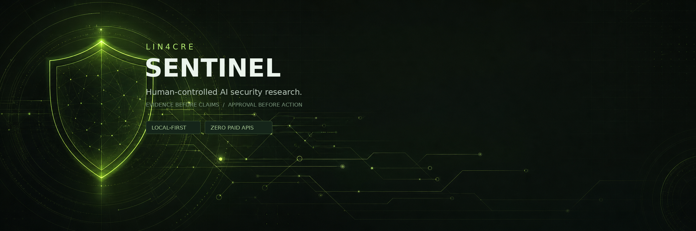

# LIN4CRE SENTINEL

**Local-first, evidence-backed vulnerability research operations with explicit human control.**

SENTINEL combines cash-only programme intelligence, exact-scope approvals, research evidence, controlled reports and actual payment accounting with a conversational operations console, real host inspection, approved maintenance, verified recovery and constrained code patches.

It starts with **no programmes, findings, submissions or earnings**. It does not invent live data, guarantee accepted reports, run arbitrary AI commands or submit reports autonomously.

## Start on Windows — no command line required

1. Download `LIN4CRE-SENTINEL-Windows-Setup.zip` from a release or from the running app’s **Maintenance** page.
2. Extract the whole archive into a permanent folder. Do not run it from inside the ZIP.
3. Open `windows/SentinelSetup.cmd`.
4. If Python is missing, the native setup window explains the official package and asks before using Windows Package Manager.
5. Select **Inspect this PC**. Inspection is read-only.
6. Choose components, review the exact plan and approve only what you want.
7. Save the actual installation report, including any failures or unavailable checks.

The graphical manager starts only loopback services, pairs the host companion, checks real hardware/software/services, offers approved plans, verifies results, creates recovery points and exposes emergency stop. It is an unsigned source package; Windows may show SmartScreen. No purchased signing certificate is included.

**Windows-specific installation success has not been verified by the build environment.** See [Windows setup](docs/WINDOWS_SETUP.md) and [Verification](docs/VERIFICATION.md).

## Android companion (preview)

A read-only Android companion is in preview development. Its APK will be published as a GitHub prerelease after the Android build workflow is able to run. It connects to a separately run, authenticated mobile API over HTTPS and can display dashboard counts, programme records and scope approvals. It cannot approve scope, run tests, modify data or operate the Windows host.

See [Android setup and security](docs/ANDROID.md). Do not expose the core API or send a bearer token over plain HTTP.

## What is implemented

### Research operation

- Cash-only programme eligibility; recognition-only opportunities are rejected.
- Explainable six-factor ranking using recorded inputs, not invented probabilities.
- Exact-asset, method-specific, rate-limited and expiring test approvals.
- Fail-closed scope, AI-policy, automation-policy and evidence gates.
- Research records, human validation, Markdown report generation and explicit submission recording.
- Separate awarded/paid accounting by currency; estimates never enter earnings.
- Append-only audit database triggers and emergency revocation.

### AI operations and maintenance

- Ordinary-language console with persisted conversations and deterministic registered intents.
- Optional local Ollama intent classification; models cannot issue shell commands.
- Real host hardware, OS/architecture, storage, ports, dependencies, services, versions, Docker, WSL, Ollama/models and OpenCode inspection.
- Official-source update checks with compatibility, security/critical classification, notes, available size and cost-review signals.
- Server-side role permissions, exact-plan SHA-256 approval, short-lived HMAC host envelopes and replay protection.
- Pre-change recovery points, installation/repair/update verification, retry and registered rollback where one exists.
- Periodic **read-only** monitoring; monitoring never installs or repairs automatically.
- Verified database/file/configuration recovery points, corruption detection, selective restore and last-known-good retention.
- Constrained local-model code patches: approved source paths only, exact diff review, protected security files, hashed source backups, syntax/build checks and reverse patch.
- Actual installation-report export and emergency stop.

## Deliberate boundaries

- Live security testing and automatic submissions are **disabled**.
- No paid AI provider is configured; external AI is disabled by default.
- No bounty-platform connector or live programme discovery is configured.
- No Ollama model is selected until the user verifies one.
- Model-digest updates are review-only: model weights are excluded from normal backups, so SENTINEL does not overwrite models without a separate verified model backup.
- WinGet downgrade/rollback is not universally supported. Registered reverse updates exist for npm packages with a known previous version; other failures are reported honestly.
- AI patches cannot modify dependency manifests, secrets, audit/approval/security policy, recovery, companion execution or arbitrary files.
- PentAGI and CyberGym are not deployed. Their large datasets are not downloaded.
- Do not expose the core or companion to a LAN/public interface. The companion has no remote-management mode.

## Architecture

```text
React + TypeScript UI
        │ same-origin /api
FastAPI + SQLite core ─────── verified recovery / append-only audit
        │ authenticated loopback HTTP + signed exact-plan envelope
Windows host companion
        │ registered read-only inspection or approved allowlisted action
Windows / Docker / Ollama / OpenCode / source files
```

The host companion binds to `127.0.0.1:8765`; the normal web app is `127.0.0.1:8000`. Host tokens and runtime databases are excluded from Git and setup archives.

## Developer quick start

Prerequisites: Python 3.12+ and Node.js 20+.

```bash
python -m pip install -r requirements.txt
npm ci
npm run build
npm run server
```

Open `http://localhost:8000`. API documentation is at `/api/docs`.

For frontend development, run `npm run server` and `npm run dev` separately, then open `http://localhost:5173`. Vite proxies `/api`.

### Docker

```bash
docker compose build
docker compose up -d
```

Open `http://localhost:8787`. The published port is loopback-only; the container runs non-root with a read-only root filesystem, dropped capabilities and no Docker socket. Back up the Docker volume before migration. Docker/Compose execution was not available in the build sandbox.

## Verification

```bash
python -m unittest discover -s tests -v
python -m compileall -q backend host_companion windows
npm run build
```

The isolated suite contains **24 tests**, covering the mobile companion, research workflow, and upgrade security/recovery paths. Browser QA has previously covered all 11 routes, real assistant responses and 390 px mobile layouts; the current sandbox has no Chromium runtime to repeat that browser run. Exact latest results and limitations are recorded in [docs/VERIFICATION.md](docs/VERIFICATION.md).

## Costs

SENTINEL adds **£0 software charge** and requests no subscription. Included application dependencies are free/open-source. Users remain responsible for electricity, hardware, internet, optional third-party software terms and any separately approved services. Upstream licences and costs must be rechecked before installation. No payout or accepted finding is guaranteed.

## Documentation

- [Windows setup and recovery](docs/WINDOWS_SETUP.md)
- [Operations guide](docs/OPERATIONS.md)
- [Security policy and threat model](SECURITY.md)
- [Verification results](docs/VERIFICATION.md)
- [Official sources](docs/SOURCES.md)
- [Recovery details](docs/RESTORE.md)
- [Contributing](CONTRIBUTING.md)
- [Changelog](CHANGELOG.md)

## Licence

MIT — see [LICENSE](LICENSE). Third-party projects retain their own licences; see [THIRD_PARTY_NOTICES.md](THIRD_PARTY_NOTICES.md).
